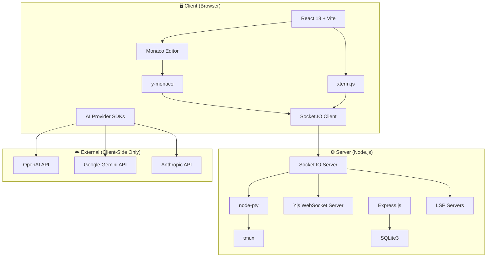

# 🛠️ Technology Stack — SyncWrite

> Every library, tool, and service used in the project, with version targets and justification.

---

## Stack Overview Diagram



---

## Frontend

| Technology | Version | Purpose | Why This? |
|------------|---------|---------|-----------|
| **React** | 18.x | UI framework | Industry standard, massive ecosystem, component-based |
| **Vite** | 5.x | Build tool & dev server | Blazing fast HMR, ESM-native, easy config |
| **TypeScript** | 5.x | Type safety | Catches bugs at compile time, better DX |
| **Monaco Editor** | 0.45+ | Code editor component | Powers VS Code, best web editor available |
| **@monaco-editor/react** | 4.x | React wrapper for Monaco | Clean React integration with hooks |
| **y-monaco** | 0.6+ | Yjs ↔ Monaco binding | Automatic CRDT sync for editor content |
| **yjs** | 13.x | CRDT engine | Most mature JS CRDT library, battle-tested |
| **y-websocket** | 1.x | Yjs WebSocket provider | Standard transport for Yjs documents |
| **xterm.js** | 5.x | Terminal emulator | Industry standard browser terminal |
| **xterm-addon-fit** | 0.8+ | Auto-resize xterm | Makes terminal fill its container |
| **xterm-addon-web-links** | 0.9+ | Clickable URLs in terminal | Better terminal UX |
| **Socket.IO Client** | 4.x | WebSocket client | Reliable transport with auto-reconnect |
| **React Router** | 6.x | Client routing | SPA navigation |
| **Zustand** | 4.x | State management | Lightweight, no boilerplate, hook-based |
| **Axios** | 1.x | HTTP client | Clean API, interceptors for auth |
| **Tailwind CSS** | 3.x | Styling | Utility-first, rapid UI development |
| **Lucide React** | 0.3+ | Icons | Clean, consistent icon set |
| **react-resizable-panels** | 2.x | Resizable layout | Draggable dividers for editor/terminal/sidebar |
| **react-hot-toast** | 2.x | Notifications | Lightweight toast library |

### AI Provider SDKs (Client-Side)

| Provider | Package | Purpose |
|----------|---------|---------|
| OpenAI | `openai` (npm) | GPT-4o / GPT-4o-mini completions |
| Google Gemini | `@google/generative-ai` | Gemini Pro / Flash completions |
| Anthropic | Direct fetch (CORS) | Claude completions via REST |

> [!IMPORTANT]
> All AI API calls are made **directly from the browser** to the provider's API. The SyncWrite server never sees or stores API keys.

---

## Backend

| Technology | Version | Purpose | Why This? |
|------------|---------|---------|-----------|
| **Node.js** | 20 LTS | Runtime | Ubiquitous, great for I/O-heavy workloads |
| **Express.js** | 4.x | HTTP framework | Minimal, flexible, huge middleware ecosystem |
| **TypeScript** | 5.x | Type safety | Shared types with frontend |
| **Socket.IO** | 4.x | WebSocket server | Rooms, namespaces, auto-reconnect, fallback transport |
| **y-websocket** | 1.x | Yjs sync server | Handles Yjs document sync protocol |
| **node-pty** | 1.x | Pseudo-terminal | Spawns real PTY processes for terminal |
| **better-sqlite3** | 11.x | SQLite driver | Synchronous, fastest SQLite binding for Node |
| **bcrypt** | 5.x | Password hashing | Industry standard, configurable cost factor |
| **jsonwebtoken** | 9.x | JWT auth | Access + refresh token generation/verification |
| **uuid** | 9.x | ID generation | Unique project/file IDs |
| **cors** | 2.x | CORS middleware | Allow cross-origin requests in development |
| **helmet** | 7.x | Security headers | XSS protection, CSP, etc. |
| **express-rate-limit** | 7.x | Rate limiting | Prevent brute-force on auth endpoints |
| **zod** | 3.x | Input validation | Schema-based validation for API inputs |
| **morgan** | 1.x | HTTP logging | Request logging for debugging |
| **dotenv** | 16.x | Environment config | Load `.env` variables |
| **chokidar** | 3.x | File watcher | Watch project directories for external changes |
| **archiver** | 6.x | ZIP creation | Download project as ZIP |

---

## LSP Servers

| Language | LSP Server | Install Method | Notes |
|----------|-----------|----------------|-------|
| **Python** | Pyright | `npm install pyright` | Fast, maintained by Microsoft |
| **JavaScript/TypeScript** | TypeScript Language Server | `npm install typescript` | Built into TypeScript package |

> [!NOTE]
> LSP servers run as child processes on the backend, one instance per active project. LSP messages are proxied to the client via WebSocket and translated to Monaco's language client protocol.

---

## Terminal & Runtime

| Technology | Purpose | Notes |
|------------|---------|-------|
| **tmux** | Terminal multiplexer | One session per user per project, persistent across reconnects |
| **node-pty** | PTY bridge | Connects tmux sessions to WebSocket via Node.js |

### Required Language Runtimes (Server)

| Language | Runtime | Compiler/Interpreter | Package Manager |
|----------|---------|---------------------|-----------------|
| Python | 3.11+ | `python3` | `pip` |
| JavaScript | Node 20+ | `node` | `npm` |
| Go | 1.21+ | `go run` / `go build` | `go mod` |
| Rust | 1.75+ | `rustc` / `cargo` | `cargo` |
| Java | 17+ | `javac` + `java` | — |
| C | GCC 12+ | `gcc` | — |
| C++ | G++ 12+ | `g++` | — |

---

## Database

| Technology | Version | Purpose |
|------------|---------|---------|
| **SQLite** | 3.40+ | All persistent data |
| **better-sqlite3** | 11.x | Node.js driver |

**Why SQLite?**
- Zero configuration, zero cost
- Single file database — easy backup, easy deploy
- Handles 100+ concurrent readers (more than enough for college project)
- No separate database server to install or maintain
- WAL mode enables concurrent reads during writes

---

## DevOps & Tooling

| Tool | Purpose |
|------|---------|
| **npm workspaces** | Monorepo management (client + server + shared) |
| **nodemon** | Auto-restart server on changes |
| **ESLint** | Code linting |
| **Prettier** | Code formatting |
| **concurrently** | Run client + server dev scripts together |

---

## Project Structure Type

```
Monorepo (npm workspaces)
├── client/     → React app (Vite)
├── server/     → Node.js API + WebSocket
└── shared/     → Shared TypeScript types & constants
```

---

## Minimum Server Requirements (Self-Hosted)

| Resource | Minimum | Recommended |
|----------|---------|-------------|
| **CPU** | 2 cores | 4 cores |
| **RAM** | 2 GB | 4 GB |
| **Disk** | 10 GB | 20 GB |
| **OS** | Ubuntu 22.04+ / Debian 12+ | Same |
| **Node.js** | 20 LTS | 20 LTS |
| **tmux** | 3.3+ | 3.3+ |

> [!TIP]
> For a college project, this runs fine on a single laptop, a free Oracle Cloud VM (4 cores, 24GB RAM), or a \$5/mo VPS.
