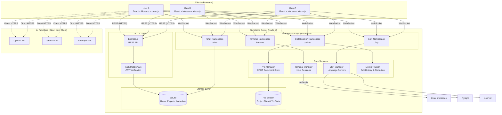
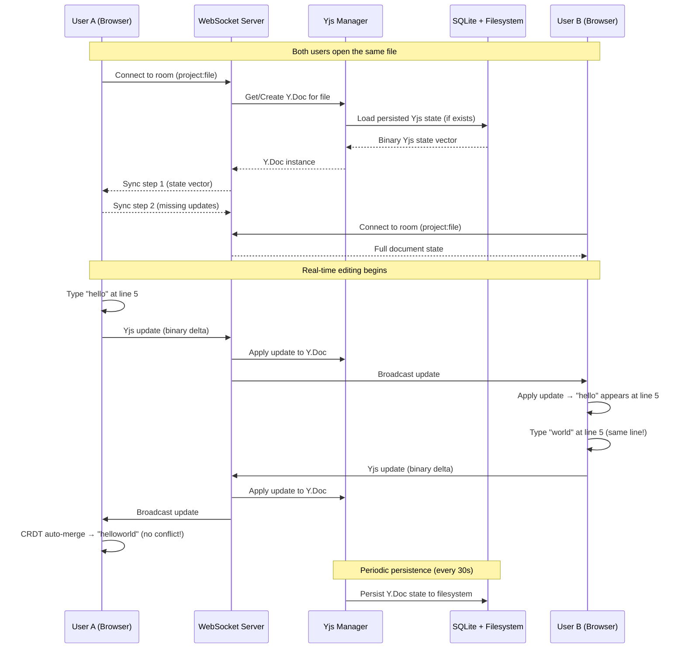
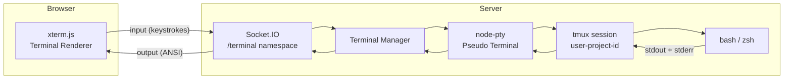
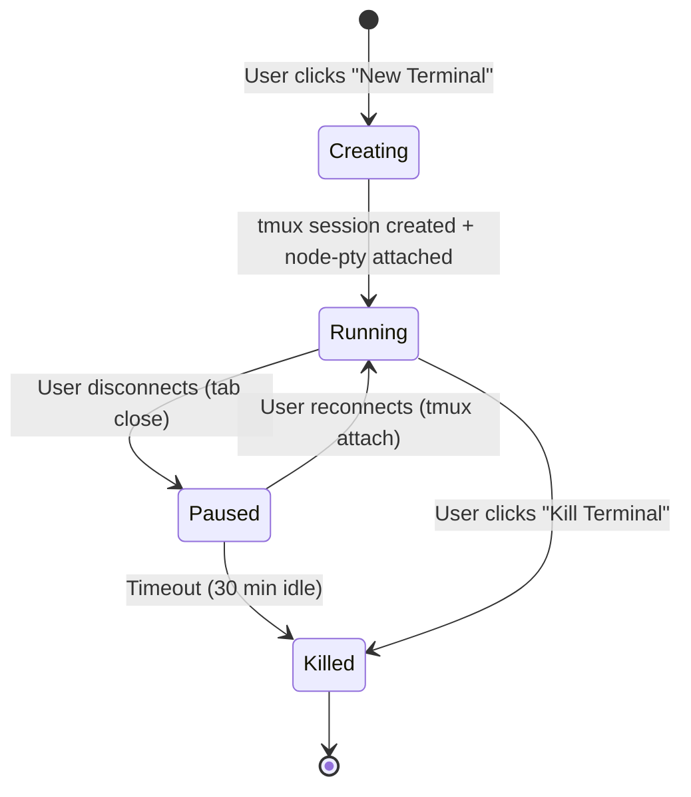
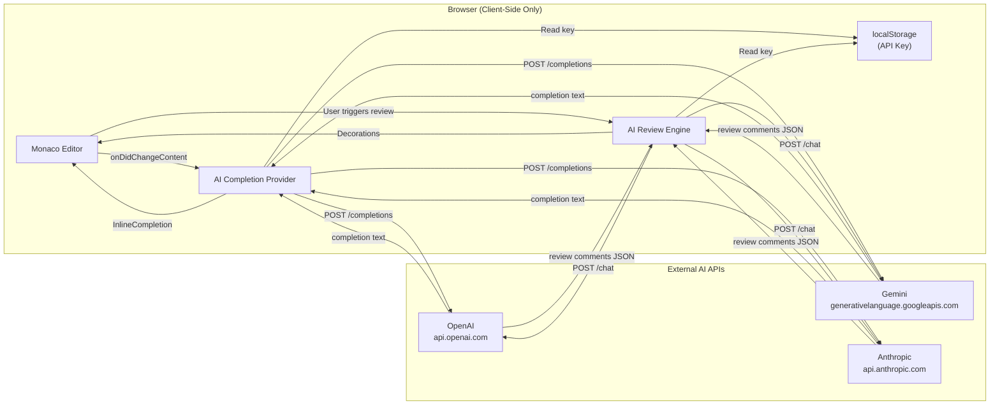
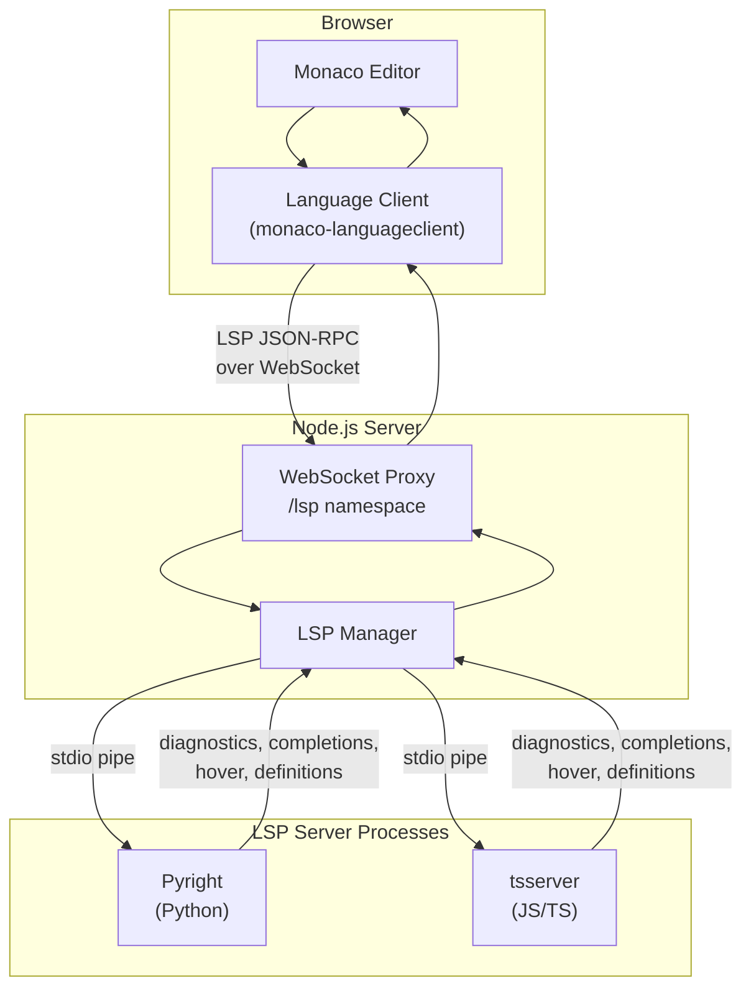
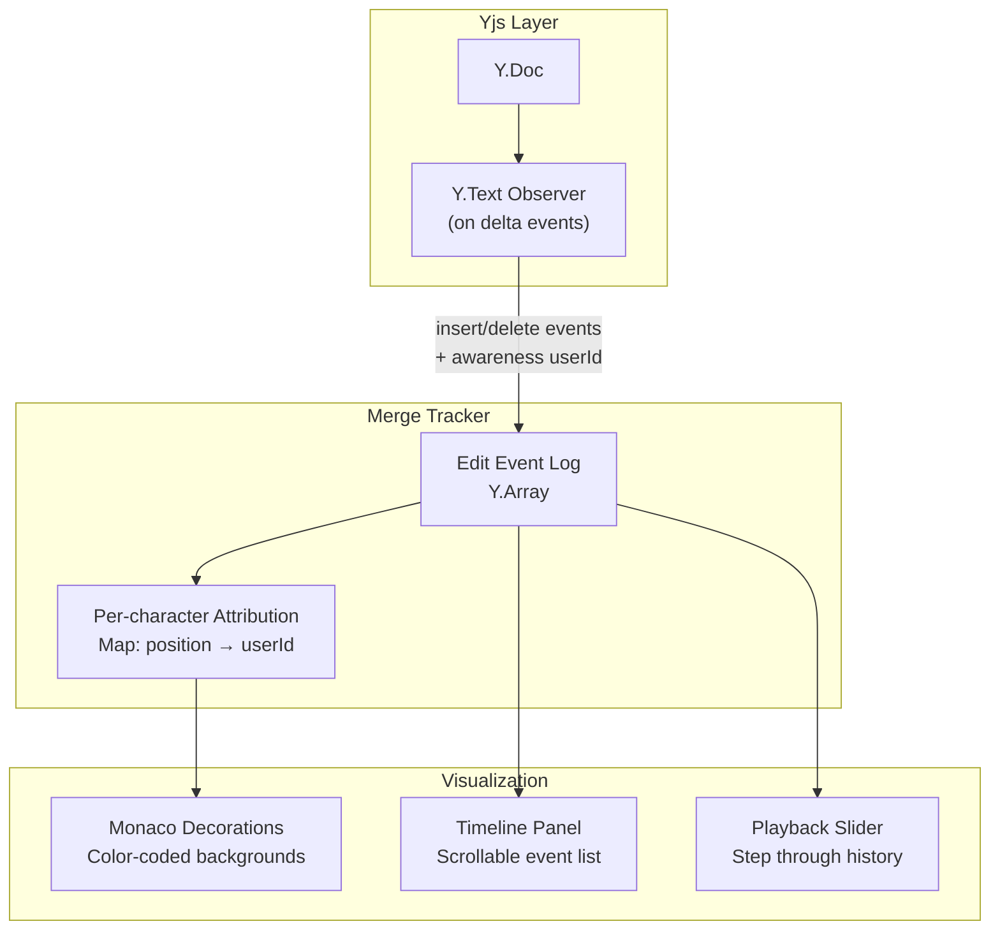
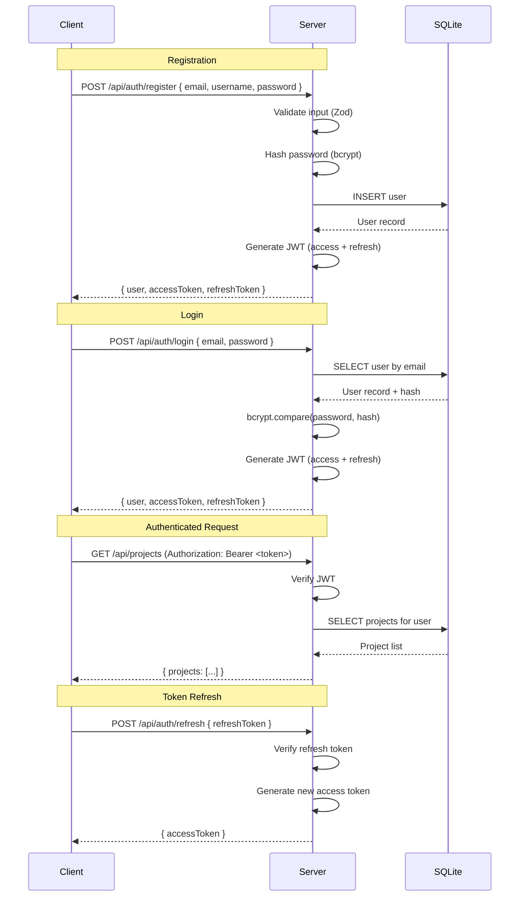
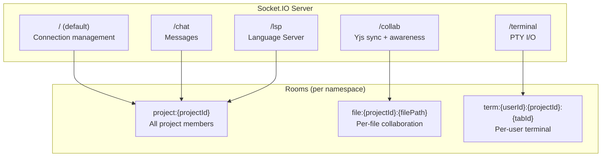
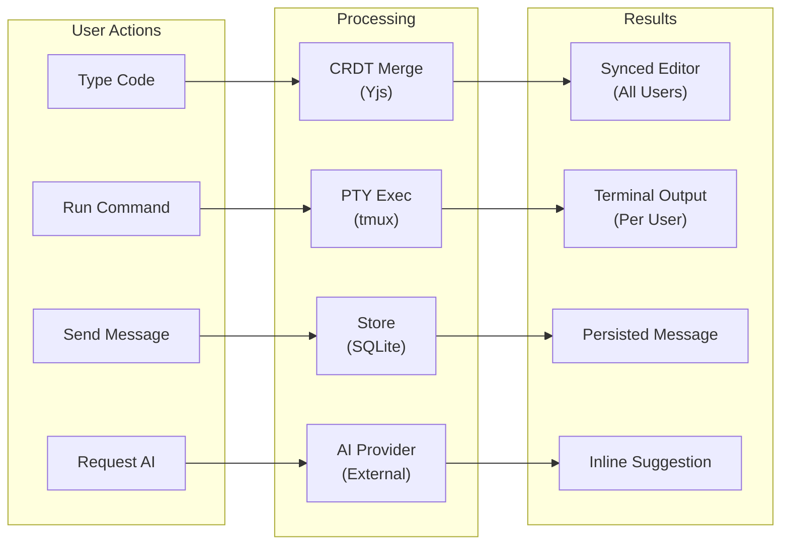

# 🏗️ System Architecture — SyncWrite

> Detailed architecture diagrams, data flows, and component interactions.

---

## 1. High-Level System Architecture



---

## 2. Collaboration Architecture (CRDT + Yjs)



### CRDT Document Model

```
Y.Doc (one per file)
├── Y.Text ("content")     → The file's text content
├── Y.Map ("metadata")     → File metadata (language, encoding)
└── Y.Array ("history")    → Edit event log for merge visualization

Awareness (ephemeral, per-connection)
├── cursor: { line, column, file }
├── selection: { start, end }
├── user: { id, name, color }
└── state: "active" | "idle" | "away"
```

---

## 3. Terminal Architecture



### Terminal Session Lifecycle



**Key Design Decisions:**
- Each user gets their own tmux session named `sw-{userId}-{projectId}-{tabIndex}`
- tmux sessions persist across WebSocket disconnects (browser close → reopen → reattach)
- Idle sessions killed after 30 minutes to conserve resources
- Terminal working directory is set to the project's filesystem root
- All 7 language runtimes available in the terminal's PATH

---

## 4. AI Integration Architecture



### AI Autocomplete Flow

1. User types in Monaco → 300ms debounce
2. `AICompletionProvider.provideInlineCompletions()` fires
3. Build prompt: `{file_content_before_cursor} + {file_language} + {instruction}`
4. Read API key from `localStorage`
5. Call selected provider's completion endpoint directly from browser
6. Parse response → return as `InlineCompletion` items
7. Monaco renders ghost text at cursor position
8. User presses Tab to accept or keeps typing to dismiss

### AI Code Review Flow

1. User clicks "AI Review" button (or Ctrl+Shift+R)
2. Build review prompt with file content + diff (if available)
3. Call AI provider with structured output request (JSON mode)
4. Parse response into array of `{ line, message, severity, suggestion }`
5. Render as Monaco decorations: gutter icons + inline hover messages
6. User can accept (apply suggestion), dismiss, or discuss in chat

---

## 5. LSP Architecture



### LSP Lifecycle

1. When a project is opened, the server checks the project's language(s)
2. If Python files exist → spawn Pyright with `rootUri` = project directory
3. If JS/TS files exist → spawn tsserver with `rootUri` = project directory
4. LSP server processes are shared among all collaborators in the same project
5. All users see the same diagnostics (errors/warnings)
6. LSP servers are killed when the last user leaves the project

---

## 6. Merge Visualization Architecture



### Edit Event Structure

```typescript
interface EditEvent {
  id: string;             // Unique event ID
  userId: string;         // Who made the edit
  userName: string;       // Display name
  userColor: string;      // User's color
  timestamp: number;      // Unix timestamp (ms)
  fileId: string;         // Which file
  type: 'insert' | 'delete' | 'replace';
  position: {
    line: number;
    column: number;
  };
  content: string;        // Inserted/deleted text
  length: number;         // Characters affected
}
```

---

## 7. Authentication Flow



---

## 8. WebSocket Namespace Design



### Socket Events Reference

| Namespace | Event | Direction | Payload |
|-----------|-------|-----------|---------|
| `/collab` | `yjs:sync` | Bidirectional | Yjs binary sync message |
| `/collab` | `awareness:update` | Bidirectional | Awareness state (cursor, selection, user) |
| `/collab` | `file:open` | Client → Server | `{ projectId, filePath }` |
| `/collab` | `file:close` | Client → Server | `{ projectId, filePath }` |
| `/collab` | `merge:event` | Server → Client | `EditEvent` object |
| `/terminal` | `terminal:create` | Client → Server | `{ projectId, shell?, cols, rows }` |
| `/terminal` | `terminal:input` | Client → Server | `{ terminalId, data }` |
| `/terminal` | `terminal:output` | Server → Client | `{ terminalId, data }` |
| `/terminal` | `terminal:resize` | Client → Server | `{ terminalId, cols, rows }` |
| `/terminal` | `terminal:kill` | Client → Server | `{ terminalId }` |
| `/chat` | `chat:message` | Bidirectional | `{ projectId, text, codeRef? }` |
| `/chat` | `chat:typing` | Client → Server | `{ projectId, userId }` |
| `/lsp` | `lsp:request` | Client → Server | JSON-RPC LSP request |
| `/lsp` | `lsp:response` | Server → Client | JSON-RPC LSP response |
| `/lsp` | `lsp:notification` | Bidirectional | JSON-RPC LSP notification |

---

## 9. Data Flow Summary


