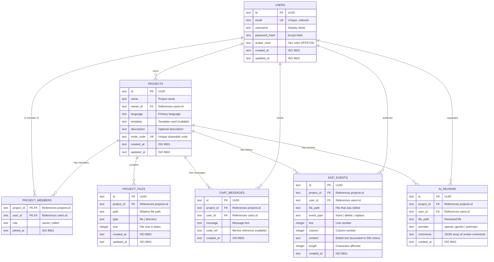

# 🗄️ Database Schema — SyncWrite

> SQLite database schema with all tables, indexes, and relationships.

---

## Entity-Relationship Diagram



---

## SQL Table Definitions

### users

```sql
CREATE TABLE users (
    id          TEXT PRIMARY KEY,
    email       TEXT NOT NULL UNIQUE,
    username    TEXT NOT NULL,
    password_hash TEXT NOT NULL,
    avatar_color TEXT NOT NULL DEFAULT '#6366F1',
    created_at  TEXT NOT NULL DEFAULT (datetime('now')),
    updated_at  TEXT NOT NULL DEFAULT (datetime('now'))
);

CREATE UNIQUE INDEX idx_users_email ON users(email);
```

### projects

```sql
CREATE TABLE projects (
    id          TEXT PRIMARY KEY,
    name        TEXT NOT NULL,
    owner_id    TEXT NOT NULL REFERENCES users(id) ON DELETE CASCADE,
    language    TEXT NOT NULL DEFAULT 'javascript',
    template    TEXT,
    description TEXT DEFAULT '',
    invite_code TEXT NOT NULL UNIQUE,
    created_at  TEXT NOT NULL DEFAULT (datetime('now')),
    updated_at  TEXT NOT NULL DEFAULT (datetime('now'))
);

CREATE INDEX idx_projects_owner ON projects(owner_id);
CREATE UNIQUE INDEX idx_projects_invite ON projects(invite_code);
```

### project_members

```sql
CREATE TABLE project_members (
    project_id  TEXT NOT NULL REFERENCES projects(id) ON DELETE CASCADE,
    user_id     TEXT NOT NULL REFERENCES users(id) ON DELETE CASCADE,
    role        TEXT NOT NULL DEFAULT 'editor' CHECK(role IN ('owner', 'editor')),
    joined_at   TEXT NOT NULL DEFAULT (datetime('now')),
    PRIMARY KEY (project_id, user_id)
);

CREATE INDEX idx_members_user ON project_members(user_id);
CREATE INDEX idx_members_project ON project_members(project_id);
```

### project_files

```sql
CREATE TABLE project_files (
    id          TEXT PRIMARY KEY,
    project_id  TEXT NOT NULL REFERENCES projects(id) ON DELETE CASCADE,
    path        TEXT NOT NULL,
    type        TEXT NOT NULL DEFAULT 'file' CHECK(type IN ('file', 'directory')),
    size        INTEGER DEFAULT 0,
    created_at  TEXT NOT NULL DEFAULT (datetime('now')),
    updated_at  TEXT NOT NULL DEFAULT (datetime('now')),
    UNIQUE(project_id, path)
);

CREATE INDEX idx_files_project ON project_files(project_id);
CREATE INDEX idx_files_path ON project_files(project_id, path);
```

### chat_messages

```sql
CREATE TABLE chat_messages (
    id          TEXT PRIMARY KEY,
    project_id  TEXT NOT NULL REFERENCES projects(id) ON DELETE CASCADE,
    user_id     TEXT NOT NULL REFERENCES users(id) ON DELETE CASCADE,
    message     TEXT NOT NULL,
    code_ref    TEXT,
    created_at  TEXT NOT NULL DEFAULT (datetime('now'))
);

CREATE INDEX idx_chat_project ON chat_messages(project_id, created_at);
```

### edit_events

```sql
CREATE TABLE edit_events (
    id          TEXT PRIMARY KEY,
    project_id  TEXT NOT NULL REFERENCES projects(id) ON DELETE CASCADE,
    user_id     TEXT NOT NULL REFERENCES users(id) ON DELETE CASCADE,
    file_path   TEXT NOT NULL,
    event_type  TEXT NOT NULL CHECK(event_type IN ('insert', 'delete', 'replace')),
    line        INTEGER NOT NULL,
    "column"    INTEGER NOT NULL,
    content     TEXT DEFAULT '',
    length      INTEGER DEFAULT 0,
    created_at  TEXT NOT NULL DEFAULT (datetime('now'))
);

CREATE INDEX idx_edit_project_file ON edit_events(project_id, file_path, created_at);
CREATE INDEX idx_edit_project_time ON edit_events(project_id, created_at);
```

### ai_reviews

```sql
CREATE TABLE ai_reviews (
    id          TEXT PRIMARY KEY,
    project_id  TEXT NOT NULL REFERENCES projects(id) ON DELETE CASCADE,
    user_id     TEXT NOT NULL REFERENCES users(id) ON DELETE CASCADE,
    file_path   TEXT NOT NULL,
    provider    TEXT NOT NULL CHECK(provider IN ('openai', 'gemini', 'anthropic')),
    comments    TEXT NOT NULL DEFAULT '[]',
    created_at  TEXT NOT NULL DEFAULT (datetime('now'))
);

CREATE INDEX idx_reviews_project ON ai_reviews(project_id, file_path);
```

---

## Yjs State Storage (Filesystem)

Yjs document state is stored on the **filesystem** (not in SQLite) for performance:

```
projects/
└── {project-id}/
    ├── .yjs/                    # Yjs persistence directory
    │   ├── {file-path}.ystate   # Binary Yjs document state
    │   └── {file-path}.ymeta    # JSON metadata (last sync time)
    ├── src/
    │   ├── main.py
    │   └── utils.py
    └── README.md
```

> [!NOTE]
> File content is the **source of truth** when no Yjs state exists (first open). Once a Yjs document is created for a file, the Yjs state becomes the source of truth and is periodically flushed back to the actual file on disk.

---

## Database Configuration

```typescript
// server/src/config/database.ts
import Database from 'better-sqlite3';
import path from 'path';

const DB_PATH = path.join(__dirname, '../../data/syncwrite.db');

const db = new Database(DB_PATH);

// Enable WAL mode for better concurrent read performance
db.pragma('journal_mode = WAL');

// Enable foreign keys
db.pragma('foreign_keys = ON');

// Performance tuning
db.pragma('synchronous = NORMAL');
db.pragma('cache_size = -64000'); // 64MB cache
db.pragma('temp_store = MEMORY');

export default db;
```

---

## Migration Runner

```typescript
// server/src/database/migrate.ts
import db from '../config/database';
import fs from 'fs';
import path from 'path';

const MIGRATIONS_DIR = path.join(__dirname, 'migrations');

function runMigrations() {
  // Create migrations tracking table
  db.exec(`
    CREATE TABLE IF NOT EXISTS migrations (
      id INTEGER PRIMARY KEY AUTOINCREMENT,
      name TEXT NOT NULL UNIQUE,
      executed_at TEXT NOT NULL DEFAULT (datetime('now'))
    )
  `);

  const executed = db.prepare('SELECT name FROM migrations')
    .all()
    .map((r: any) => r.name);

  const files = fs.readdirSync(MIGRATIONS_DIR)
    .filter(f => f.endsWith('.sql'))
    .sort();

  for (const file of files) {
    if (!executed.includes(file)) {
      const sql = fs.readFileSync(path.join(MIGRATIONS_DIR, file), 'utf-8');
      db.exec(sql);
      db.prepare('INSERT INTO migrations (name) VALUES (?)').run(file);
      console.log(`✅ Migration: ${file}`);
    }
  }
}

export default runMigrations;
```
