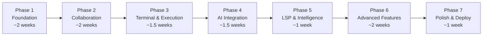

# 🚀 MVP Definition & Build Plan — SyncWrite

> Phased development plan from zero to full-featured collaborative IDE.

---

## MVP Scope (Minimum Viable Product)

The MVP is the **smallest build that demonstrates all core value propositions**. A user should be able to:

1. ✅ Register & log in
2. ✅ Create a project (blank or from template)
3. ✅ See a file tree and navigate files
4. ✅ Edit code in Monaco with syntax highlighting
5. ✅ Invite another user and edit the **same file** simultaneously (CRDT)
6. ✅ See the other user's cursor in real-time
7. ✅ Open a private terminal and run code
8. ✅ Get AI autocomplete suggestions (with their own API key)

**Everything else is post-MVP enhancement.**

---

## Build Phases

---

## Phase 1: Foundation (~2 weeks)

> **Goal:** Working monorepo with auth, project CRUD, file management, and basic Monaco editor.

### Week 1: Backend Setup

| Task | Details | Files |
|------|---------|-------|
| **1.1** Initialize monorepo | npm workspaces, TypeScript configs, ESLint, Prettier | Root configs |
| **1.2** Express server setup | App, server, middleware stack | `server/src/app.ts`, `server.ts`, `index.ts` |
| **1.3** SQLite database | Connection, migrations, seed | `server/src/database/*`, `config/database.ts` |
| **1.4** Auth system | Register, login, JWT, bcrypt | `routes/auth.routes.ts`, `controllers/auth.controller.ts`, `services/auth.service.ts`, `middleware/auth.middleware.ts` |
| **1.5** Shared types | User, Project, File types | `shared/src/types/*` |

**Deliverable:** Auth endpoints working (test with cURL/Postman).

### Week 2: Frontend + Files

| Task | Details | Files |
|------|---------|-------|
| **1.6** React + Vite setup | Tailwind, routing, Zustand stores | `client/` base setup |
| **1.7** Auth pages | Login, register, protected routes | `pages/Login.tsx`, `Register.tsx`, `components/auth/*` |
| **1.8** Dashboard page | Project list, create modal | `pages/Dashboard.tsx`, `components/project/*` |
| **1.9** Project CRUD API | Create, list, get, delete projects | `routes/project.routes.ts`, `controllers/project.controller.ts` |
| **1.10** File system API | Tree, read, create, update, delete, rename | `routes/file.routes.ts`, `controllers/file.controller.ts`, `services/file.service.ts` |
| **1.11** File tree UI | Recursive tree, context menu, icons | `components/filetree/*` |
| **1.12** Monaco editor | Basic editor with tabs, syntax highlighting | `components/editor/CodeEditor.tsx`, `EditorTabs.tsx` |
| **1.13** IDE layout | Sidebar + editor + (placeholder) terminal layout | `components/layout/*` |

**Deliverable:** User can register, create a project, see file tree, edit files in Monaco. Single-user only.

### Phase 1 Checkpoint ✅
- [ ] Auth flow (register → login → dashboard)
- [ ] Project CRUD (create, list, delete)
- [ ] File tree (create/rename/delete files and folders)
- [ ] Monaco editor with syntax highlighting and tabs
- [ ] File content saved to server via REST

---

## Phase 2: Real-Time Collaboration (~2 weeks)

> **Goal:** Multiple users editing the same file in real-time with visible cursors.

### Week 3: Yjs + WebSocket

| Task | Details | Files |
|------|---------|-------|
| **2.1** Socket.IO server | Server setup, auth middleware, namespaces | `websocket/index.ts`, `middleware/wsAuth.ts` |
| **2.2** Yjs Manager | Document lifecycle, load/persist Y.Doc | `collaboration/YjsManager.ts`, `DocumentStore.ts` |
| **2.3** Collaboration handler | Yjs sync protocol over Socket.IO | `websocket/handlers/collaboration.handler.ts` |
| **2.4** Client Yjs setup | y-websocket provider, y-monaco binding | `hooks/useYjs.ts`, `context/YjsContext.tsx` |
| **2.5** Bind Monaco to Yjs | Replace REST-based editing with CRDT sync | Update `CodeEditor.tsx` |

**Deliverable:** Two browser tabs editing the same file — changes appear in real-time.

### Week 4: Presence + Invite

| Task | Details | Files |
|------|---------|-------|
| **2.6** Awareness protocol | Cursor position, selection, user info | `collaboration/AwarenessManager.ts`, `hooks/useAwareness.ts` |
| **2.7** Collaborative cursors | Colored cursors + name labels in Monaco | `components/editor/CollaborativeCursors.tsx` |
| **2.8** Presence panel | Online users list in sidebar | `components/collaboration/PresencePanel.tsx`, `UserAvatar.tsx` |
| **2.9** Invite system | Generate invite code, join via link | `project.controller.ts` (invite/join), `pages/JoinProject.tsx`, `InviteModal.tsx` |
| **2.10** Presence handler | Join/leave events, online user tracking | `websocket/handlers/presence.handler.ts` |
| **2.11** File open tracking | Show which file each user has open | Update awareness state |

**Deliverable:** Two users on different machines can join same project, see each other's cursors, and edit simultaneously.

### Phase 2 Checkpoint ✅
- [ ] Yjs CRDT sync working (no data loss on concurrent edits)
- [ ] Remote cursors visible with colors and names
- [ ] Presence panel shows online users
- [ ] Invite link works (share → join → collaborate)
- [ ] Yjs state persisted to disk (survives server restart)

---

## Phase 3: Terminal & Code Execution (~1.5 weeks)

> **Goal:** Each user can open private terminals and run code in any of the 7 languages.

### Week 5

| Task | Details | Files |
|------|---------|-------|
| **3.1** Terminal Manager | tmux session lifecycle (create, attach, kill, cleanup) | `terminal/TerminalManager.ts`, `TmuxSession.ts` |
| **3.2** Terminal WebSocket handler | Input/output/resize events | `websocket/handlers/terminal.handler.ts` |
| **3.3** xterm.js integration | Terminal component with fit addon | `components/terminal/Terminal.tsx`, `TerminalPanel.tsx` |
| **3.4** Terminal tabs | Multiple terminals per user | `components/terminal/TerminalTabs.tsx` |
| **3.5** Terminal hooks & store | Client-side terminal state | `hooks/useTerminal.ts`, `store/terminalStore.ts` |
| **3.6** Layout integration | Resizable terminal panel at bottom | Update `AppLayout.tsx` |
| **3.7** Session cleanup | Kill idle sessions (30 min timeout) | `terminal/SessionCleanup.ts` |

### Week 5.5: Templates

| Task | Details | Files |
|------|---------|-------|
| **3.8** Template files | Boilerplate for all 9 templates | `server/src/templates/*/` |
| **3.9** Template service | Copy template files to new project | `services/template.service.ts` |
| **3.10** Template API | List templates endpoint | `routes/template.routes.ts`, `controllers/template.controller.ts` |
| **3.11** Template UI | Template picker in create project modal | `components/project/TemplateSelector.tsx` |

**Deliverable:** User creates a Python Flask project from template → opens terminal → runs `python app.py` → sees output.

### Phase 3 Checkpoint ✅
- [ ] Private terminal per user (tmux-backed)
- [ ] All 7 languages runnable (python, node, go, rust, java, gcc, g++)
- [ ] Multiple terminal tabs
- [ ] Terminal persists across page reload (tmux attach)
- [ ] All 9 templates working
- [ ] Template creates project with correct files and run command

---

## Phase 4: AI Integration (~1.5 weeks)

> **Goal:** AI-powered autocomplete and code review, with user-provided API keys.

### Week 6

| Task | Details | Files |
|------|---------|-------|
| **4.1** AI settings modal | Provider dropdown, API key input, save to localStorage | `components/ai/AISettingsModal.tsx` |
| **4.2** AI provider wrappers | OpenAI, Gemini, Anthropic API calls | `components/ai/providers/*.ts` |
| **4.3** Autocomplete provider | Monaco InlineCompletionProvider | `components/editor/AICompletionProvider.ts` |
| **4.4** Integration with Monaco | Register provider, handle accept/dismiss | Update `CodeEditor.tsx` |
| **4.5** AI store & hook | Provider state, key management | `store/aiStore.ts`, `hooks/useAI.ts` |

### Week 6.5: Code Review

| Task | Details | Files |
|------|---------|-------|
| **4.6** Review trigger UI | "AI Review" button in editor toolbar | `components/ai/AIReviewTrigger.tsx` |
| **4.7** Review engine | Build review prompt, parse structured response | Update `providers/*.ts` |
| **4.8** Review panel | Display comments in sidebar | `components/ai/AIReviewPanel.tsx`, `AIReviewComment.tsx` |
| **4.9** Monaco decorations | Gutter icons + inline hover for review comments | Update `CodeEditor.tsx` |
| **4.10** Review persistence | Save/load reviews via REST API | `routes/review.routes.ts`, `controllers/review.controller.ts` |
| **4.11** Review hook | Client-side review lifecycle | `hooks/useAIReview.ts` |

**Deliverable:** User enters OpenAI key → types code → sees ghost-text suggestions → clicks "Review" → sees inline comments.

### Phase 4 Checkpoint ✅
- [ ] AI autocomplete works with OpenAI
- [ ] AI autocomplete works with Gemini
- [ ] AI autocomplete works with Anthropic
- [ ] Ghost text appears and is accepted with Tab
- [ ] AI code review produces meaningful inline comments
- [ ] Review comments visible as Monaco decorations
- [ ] API keys never sent to server (verify in network tab)

---

## Phase 5: LSP & Language Intelligence (~1 week)

> **Goal:** Real IDE intelligence — diagnostics, hover, go-to-definition for Python and JS/TS.

### Week 7

| Task | Details | Files |
|------|---------|-------|
| **5.1** LSP Manager | Spawn/manage LSP server processes | `lsp/LSPManager.ts` |
| **5.2** Python LSP config | Pyright spawn with project rootUri | `lsp/servers/python.ts` |
| **5.3** TypeScript LSP config | tsserver spawn with project rootUri | `lsp/servers/typescript.ts` |
| **5.4** JSON-RPC framing | Stdio ↔ JSON-RPC message parsing | `lsp/protocol.ts` |
| **5.5** LSP WebSocket handler | Proxy LSP messages client ↔ server | `websocket/handlers/lsp.handler.ts` |
| **5.6** Monaco language client | Configure Monaco LSP features | `hooks/useLSP.ts` |
| **5.7** Diagnostics rendering | Error/warning squiggles in editor | Automatic via Monaco |

**Deliverable:** Open a Python file → see red squiggles for errors → hover a function for docs → Ctrl+click for go-to-definition.

### Phase 5 Checkpoint ✅
- [ ] Pyright diagnostics visible in editor (Python files)
- [ ] tsserver diagnostics visible (JS/TS files)
- [ ] Hover information works
- [ ] Go-to-definition works (Ctrl+Click)
- [ ] LSP completions work (in addition to AI completions)
- [ ] LSP server starts/stops with project lifecycle

---

## Phase 6: Advanced Features (~2 weeks)

> **Goal:** Merge visualization, chat, and polish.

### Week 8: Merge Visualization

| Task | Details | Files |
|------|---------|-------|
| **6.1** Merge Tracker | Record edit events with user attribution | `collaboration/MergeTracker.ts` |
| **6.2** Edit event API | Store/retrieve edit history | `routes/history.routes.ts`, `models/EditEvent.ts` |
| **6.3** Color-coded editor overlays | Highlight recent edits by user color | `components/editor/MergeVisualizer.tsx` |
| **6.4** Timeline panel | Scrollable list of merge events | `components/editor/MergeTimeline.tsx` |
| **6.5** Playback mode | Step through editing history with slider | `components/editor/MergePlayback.tsx` |
| **6.6** Merge history hook | Client-side history state | `hooks/useMergeHistory.ts` |

### Week 9: Chat + Polish

| Task | Details | Files |
|------|---------|-------|
| **6.7** Chat backend | Store messages, WebSocket events | `websocket/handlers/chat.handler.ts`, `routes/chat.routes.ts` |
| **6.8** Chat UI | Chat panel, messages, input, typing indicator | `components/collaboration/ChatPanel.tsx`, `ChatMessage.tsx`, `ChatInput.tsx` |
| **6.9** Code-linked chat | Select code → "Discuss this" → chat message with reference | `ChatInput.tsx`, `ContextMenu` integration |
| **6.10** Project download | ZIP download endpoint + UI button | `file.controller.ts`, ProjectSettings |
| **6.11** Theme toggle | Dark/light mode with persistence | `context/ThemeContext.tsx`, `store/settingsStore.ts` |
| **6.12** Error boundaries | React error boundaries for resilience | `components/common/ErrorBoundary.tsx` |
| **6.13** Loading states | Skeletons and spinners | Throughout components |
| **6.14** Keyboard shortcuts | Ctrl+S, Ctrl+P, Ctrl+Shift+R, etc. | `MonacoConfig.ts` |

**Deliverable:** Full-featured collaborative IDE with merge visualization, chat, and polished UI.

### Phase 6 Checkpoint ✅
- [ ] Edit attribution visible (color-coded backgrounds)
- [ ] Timeline shows chronological edit events
- [ ] Playback mode steps through history
- [ ] Chat works in real-time
- [ ] Code-linked chat references work
- [ ] Dark/light theme toggle
- [ ] Project ZIP download works

---

## Phase 7: Polish & Deploy (~1 week)

> **Goal:** Production-ready, deployable, documented.

### Week 10

| Task | Details |
|------|---------|
| **7.1** Security audit | Input sanitization, rate limiting, CSP headers |
| **7.2** Performance testing | 5 concurrent users on same file, measure latency |
| **7.3** Error handling | Graceful degradation, reconnection logic |
| **7.4** README documentation | Setup guide, architecture overview, screenshots |
| **7.5** Environment config | Production .env template, build scripts |
| **7.6** Deployment guide | Ubuntu/Debian setup script (Node, tmux, runtimes) |
| **7.7** Demo recording | Screen recording of 2-user collaboration demo |

### Phase 7 Checkpoint ✅
- [ ] No crash on WebSocket disconnect + reconnect
- [ ] Rate limiting on auth endpoints
- [ ] README with screenshots and setup instructions
- [ ] `npm run build` produces deployable artifacts
- [ ] Setup script installs all dependencies on fresh Ubuntu

---

## Timeline Summary

| Phase | Duration | Cumulative |
|-------|----------|------------|
| Phase 1: Foundation | 2 weeks | 2 weeks |
| Phase 2: Collaboration | 2 weeks | 4 weeks |
| Phase 3: Terminal & Templates | 1.5 weeks | 5.5 weeks |
| Phase 4: AI Integration | 1.5 weeks | 7 weeks |
| Phase 5: LSP | 1 week | 8 weeks |
| Phase 6: Advanced Features | 2 weeks | 10 weeks |
| Phase 7: Polish & Deploy | 1 week | **11 weeks** |

> [!NOTE]
> **Total estimated time: ~11 weeks** (assuming ~20-25 hours/week of development). For a college minor project with a team of 2-3, this is achievable in one semester. Phases 1-4 alone (7 weeks) produce a fully functional MVP.

---

## Risk Mitigation

| Risk | Likelihood | Impact | Mitigation |
|------|-----------|--------|------------|
| Yjs sync issues under load | Medium | High | Test with 5+ concurrent users early (Phase 2) |
| tmux/node-pty crashes | Medium | Medium | Wrap in try/catch, auto-restart sessions |
| AI provider CORS issues | High | Medium | Use proxy if direct calls fail (Anthropic doesn't support browser CORS) |
| LSP server memory usage | Medium | Medium | Limit to 2 LSP servers per project, kill on project close |
| SQLite write contention | Low | Low | WAL mode + retry logic |
| Monaco + Yjs binding bugs | Low | High | Pin y-monaco version, test edge cases |

> [!WARNING]
> **Anthropic's API does not support CORS from browsers.** For Claude support, you'll need a lightweight server-side proxy endpoint that forwards requests. The user's API key is sent in the request body (not stored on server). Alternatively, skip Anthropic for MVP and support OpenAI + Gemini only.
